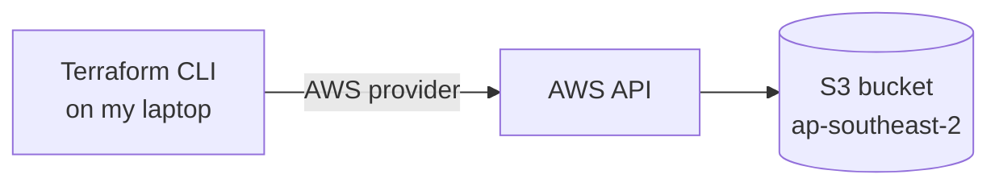

# Terraform S3 Bucket

My first Infrastructure as Code project: an Amazon S3 bucket created, inspected, and destroyed with Terraform instead of the AWS console.

I started this project with no Terraform experience. This README documents what I built, how to run it, what I learned, and the problems I ran into along the way.

**Status:** In progress. The base bucket is done. Versioning, encryption, and public access settings are planned next (see [Roadmap](#roadmap)).

## What this project does

- Configures the AWS provider for Terraform
- Creates one S3 bucket in the `ap-southeast-2` (Sydney) region
- Can remove the bucket again with a single command, so the whole setup is reproducible from code



## Tools

| Tool | Version |
|---|---|
| Terraform | 1.16.5 |
| AWS provider (`hashicorp/aws`) | `~> 6.0` |
| AWS CLI | 2.37.12 |
| Git | 2.45.2 |

## Project structure

```
terraform-s3-bucket/
├── terraform.tf          # Terraform and provider version requirements
├── main.tf               # Provider configuration and the S3 bucket
├── .terraform.lock.hcl   # Exact provider version used (committed on purpose)
├── .gitignore            # Keeps state files and the .terraform folder out of Git
└── README.md
```

The configuration itself is small:

```hcl
provider "aws" {
  region = "ap-southeast-2"
}

resource "aws_s3_bucket" "my_bucket" {
  bucket = "nizar-terraform-s3-bucket-2026"
}
```

## How to run

Prerequisites: Terraform, the AWS CLI, and an AWS account you are signed in to from the terminal.

```bash
# 1. Sign in to AWS (credentials stay outside this repository)
aws login
aws sts get-caller-identity

# 2. Download the provider
terraform init

# 3. Check formatting and syntax
terraform fmt
terraform validate

# 4. Preview, then create
terraform plan
terraform apply

# 5. Clean up
terraform destroy
```

If you reuse this code, change the bucket name in `main.tf`. Bucket names are unique across all of AWS.

## Result

`terraform plan` reported one resource to create:

```
Plan: 1 to add, 0 to change, 0 to destroy.
```

`terraform apply` then created the bucket:

```
aws_s3_bucket.my_bucket: Creating...
aws_s3_bucket.my_bucket: Creation complete after 8s [id=nizar-terraform-s3-bucket-2026]

Apply complete! Resources: 1 added, 0 changed, 0 destroyed.
```

The bucket as it appeared in the AWS console:


Afterwards I removed it again with `terraform destroy`.

## What I learned

**The Terraform workflow.** Every change follows the same loop: write configuration, `plan`, `apply`, verify, commit. `plan` changes nothing in AWS. It only shows what would happen, and the summary line (`1 to add, 0 to change, 0 to destroy`) is the first thing to read.

**How a configuration is put together.**

- The `terraform` block declares which provider plugin is needed and which versions are acceptable.
- The `provider` block configures that plugin, here the region.
- A `resource` block has a type (`aws_s3_bucket`) and a local name (`my_bucket`). Together they form the resource address `aws_s3_bucket.my_bucket`, which is what appears in the plan output.

**Reading a plan.** I wrote one argument, but the plan lists dozens of attributes. They come from three places: values I set, defaults, and values marked `(known after apply)` that only exist once AWS has created the resource.

**State.** Terraform records what it created in `terraform.tfstate` and compares that file with the configuration and with AWS. The state file can contain sensitive data, so it is excluded from Git.

**Credentials.** The AWS provider uses the same credentials as the AWS CLI, so no keys appear in the code. Credentials live in my user profile folder, outside the repository.

**Commit hygiene.** One logical change per commit, committed only after `validate` or `apply` succeeds, and always after checking `git status` so that no state file or credential is included.

## Problems I ran into

### 1. A service control policy blocked Terraform in a lab account

I first tried this in an AWS Academy lab account. `terraform apply` created the bucket and then failed:

```
Error: reading S3 Bucket (...) object lock configuration: operation error S3:
GetObjectLockConfiguration, https response error StatusCode: 403 ...
api error AccessDenied: ... is not authorized to perform:
s3:GetBucketObjectLockConfiguration ... with an explicit deny in a service control policy
```

What I learned from it:

- The error message says who was denied, which action, on which resource, and which kind of policy caused it.
- A service control policy (SCP) is set at the organization level. An explicit deny there overrides any permission inside the account, and I could not change it.
- After creating a bucket, Terraform reads all of its settings back. The `aws_s3_bucket` resource always reads the object lock configuration, so it could not work in that account.

I moved the project to a personal AWS account, where the same code worked without changes.

### 2. Cleaning up a half-finished apply

The failed apply left a real bucket in AWS and an entry in the state. A normal `terraform destroy` refreshes the resource first, which hit the same denied action. Skipping the refresh solved it:

```bash
terraform destroy -refresh=false
```

My first attempt at this also failed with `AccessDenied`, this time from an identity-based policy named `voc-cancel-cred`. The lab session credentials on my laptop were no longer valid. After I copied fresh credentials from the lab, the destroy succeeded.

### 3. A bucket name that was not available yet

In the new account I reused the bucket name I had just deleted in the lab account. `terraform apply` stayed on `Still creating...` for more than nine minutes. After I interrupted it once with `Ctrl+C` and changed the bucket name, the bucket was created in 8 seconds.

Bucket names are global, and the most likely cause is that AWS had not yet released the deleted name for use by another account, so Terraform kept retrying.

### 4. A shell variable that created a folder inside the repository

I ran `mkdir $HOME\.aws` in the VS Code terminal to create the credentials folder. The terminal was `cmd`, not PowerShell, so `$HOME` was treated as plain text and a folder named `$HOME` appeared inside the repository. I noticed before saving any credentials, deleted the folder, and used `%USERPROFILE%` instead. Since then I check `git status` before every commit.

## Roadmap

- [x] Provider configuration and base bucket
- [ ] Bucket versioning
- [ ] Server-side encryption
- [ ] Block Public Access settings
- [ ] Tags
- [ ] Variables and outputs
- [ ] Feature branches and pull requests for each change

## References

- [Terraform: Get Started with AWS](https://developer.hashicorp.com/terraform/tutorials/aws-get-started)
- [`aws_s3_bucket` resource documentation](https://registry.terraform.io/providers/hashicorp/aws/latest/docs/resources/s3_bucket)
- [Terraform CLI commands](https://developer.hashicorp.com/terraform/cli/commands)
- [S3 bucket naming rules](https://docs.aws.amazon.com/AmazonS3/latest/userguide/bucketnamingrules.html)
- [Service control policies](https://docs.aws.amazon.com/organizations/latest/userguide/orgs_manage_policies_scps.html)